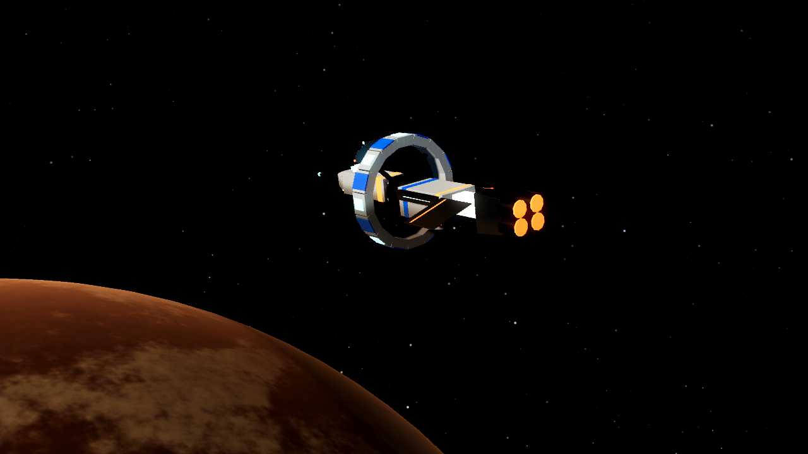
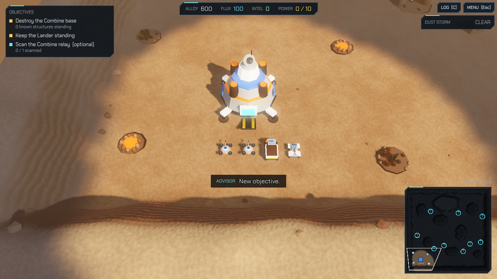

# Farlanding

Build a foothold on an unfamiliar world. Follow what it leaves behind.

Farlanding is a single-player 3D real-time strategy game about a survey expedition
beyond familiar space. Build bases, command a growing force, and uncover a trail
of discoveries that changes what your expedition can do. Made with Godot and Blender.

**[Play in your browser](https://farlanding.vercel.app)** ·
[Player guide](docs/PLAYER_GUIDE.md) · [Development plan](docs/PLAN.md)



## An expedition, one landing at a time

Travel aboard the *Meridian* and choose where to land next. On the surface,
establish a base, gather resources, produce units, and respond to an enemy with
its own foothold. Each mission adds a different reason to explore.

- **Build and command.** Grow from a small landing crew into a working base and an army.
- **Look beyond the battle.** Scan unusual signals and gather intel to unlock new options.
- **Adapt to the planet.** Weather, terrain and local conditions change how you move and fight.
- **Bring discoveries home.** Invest in your expedition between missions and shape your next landing.

Some missions reward a strong assault. Others call for a quiet approach or a
careful search. The screenshots show the first world; the rest is yours to discover.



## Start playing

The browser build needs a desktop browser with WebGL2, a keyboard and a mouse.
Click **Play Farlanding**, then choose **New campaign** or **Single missions**.
Press **F1** for controls or **Esc** for the pause menu.

High graphics uses full 3D resolution, shadows, glow and 2× antialiasing. Choose
**Balanced** or **Performance** in the launcher if your GPU needs a lighter preset.
Saved graphics choices are remembered. [Graphics details and measurements](docs/WEB_GRAPHICS.md).

Browser saves stay at the same origin in the same browser. Wait for the saved
confirmation before closing or reloading; clearing site data removes those saves.
Use the stable play link above to keep the same origin between updates.

## Run locally

Open `game/` in **Godot 4.7.2** and press Play, or run:

```sh
godot --path game
```

To build and serve the browser version, install the matching export templates,
then run:

```sh
tools/install_godot_templates.sh
tools/export.sh Web
python3 tools/serve_web.py build/web
```

Open **http://127.0.0.1:8060**. Keep the server running; opening `index.html`
as a local file will not work. [Browser build and deployment guide](docs/WEB_DEVELOPMENT.md).

## Development

Game code lives in `game/`, the scripted Blender pipeline in `art/`, and sound
sources in `audio_src/`. Definitions are resources; gameplay runs on simulation
ticks, with presentation and audio responding to events.

Run `tools/check.sh` before pushing. CI checks native behavior and browser gameplay.
Successful pushes to `main` deploy the tested browser artifact to Vercel after
staged checks pass.

| Read | For |
| --- | --- |
| [Plan](docs/PLAN.md) | Game design, architecture and phased development |
| [Field-kit verification](docs/FIELD_KIT_RESULTS.md) | UI, Survey Log, numbered groups and movement checks |
| [Conventions](docs/CONVENTIONS.md) | Code structure and contribution checks |
| [Art style](docs/ART_STYLE.md) | Visual identity and Blender asset generation |
| [Audio style](docs/AUDIO_STYLE.md) | Sound identity and the synthesis pipeline |
| [Browser development](docs/WEB_DEVELOPMENT.md) | Exports, Playwright checks and Vercel CI |
| [Graphics qualification](docs/WEB_GRAPHICS.md) | Profiles, visual references and GPU measurements |
| [Performance](docs/PERFORMANCE.md) | Simulation and rendering benchmarks |
| [Architecture decisions](docs/adr/) | Decisions and their tradeoffs |

Rebuild generated assets:

```sh
blender -b -P art/pipeline/build_all.py
uv run --python 3.12 --with numpy==2.5.4 --with scipy==1.18.1 audio_src/build.py
```

Released under the [MIT license](LICENSE).
