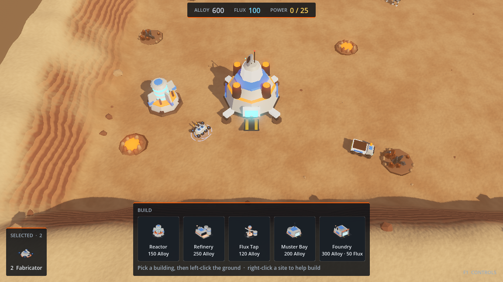

# Farlanding

A single-player 3D real-time strategy game about a survey expedition following
a trail of beacons across unknown planets. Built with Godot 4.7 and Blender.



## Run it

Open `game/` in Godot 4.7.2 and press Play, or:

```
godot --path game
```

## Play

**New campaign** puts you aboard the *Meridian*, the expedition carrier. The star map
shows the route of landings: hover one for its orbital scan (planet, rule, mission
type, unresolved `?` signals), click an open one and press LAUNCH. A won landing banks
the Intel you still hold when it ends (a lost one banks nothing, but its finds stay in
the codex) and opens the landings it leads to; the route branches, and taking one side
closes the other. On the Meridian (MERIDIAN on the star map) spend banked Intel on the
tech web: clear the Survey Lab, Lancer, Sentry and Arc, upgrade Haulers, scanners and
optics; some techs need an Antecedent find from an earlier landing. Pick a loadout
(escort squad, a pre-charged ship ability, cargo). Every later landing starts with
all of it, and the briefing lists what it brings. The campaign autosaves after every
landing and purchase; **Continue** picks it up. **Single missions** plays any landing
on its own.

Landings are on Kessel Reach (Conquest, Survey or Infiltration) and, as a placeholder
until its own map exists, Thalassa Low. Dust storms sweep Kessel's basin every few
minutes: everyone sees half as far, ground units slow down and long guns lose reach
(the gauge under the top-right buttons counts the next one down). Field notes explain
each new thing the first time you meet it.

| Input | Does |
|---|---|
| Left click (classic scheme) | select, and command by context: move, attack, harvest, scan, build, rally |
| Right click (classic scheme) | deselect, cancel placement or aiming |
| Shift | add to selection, queue orders |
| Ctrl+1–9 / 1–9 | store / recall a control group |
| WASD, arrows, screen edge, middle drag | pan · wheel: zoom · Q/E: turn |
| C | codex · F1: all controls · F3: debug overlay |
| Esc | pause menu: resume, settings, restart, quit (to the star map or the missions) |

Settings (from the title, the mission list or the pause menu): volumes, mouse scheme (classic or
modern: left selects, right commands), edge-pan, pan speed, fullscreen, quality,
resolution scale, and "Reset hints".

## Work on it

| Read | For |
|---|---|
| `docs/PLAN.md` | Game design, architecture and the phased build plan |
| `docs/CONVENTIONS.md` | Code conventions |
| `docs/ART_STYLE.md` | Visual style and the scripted Blender pipeline |
| `docs/AUDIO_STYLE.md` | Sound identity and the synthesis pipeline |
| `docs/adr/` | Decisions that would be expensive to reverse |

Before pushing, run `tools/check.sh` (format, lint, import, script check,
tests, boot test, mission smoke test). CI runs the same script. Performance numbers
and how to measure them: `docs/PERFORMANCE.md`.

Rebuild generated assets:

```
blender -b -P art/pipeline/build_all.py
uv run --python 3.12 --with numpy --with scipy audio_src/build.py
```
