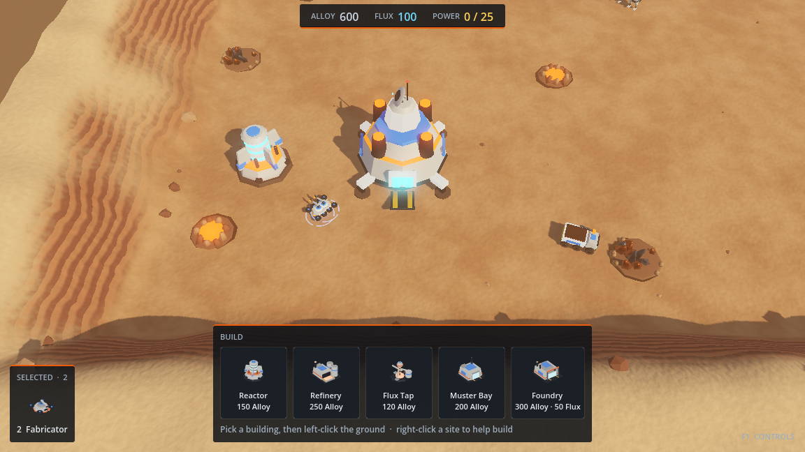

# Farlanding

A single-player 3D real-time strategy game about a survey expedition following
a trail of beacons across unknown planets. Built with Godot 4.7 and Blender.



## Run it

Open `game/` in Godot 4.7.2 and press Play, or:

```
godot --path game
```

## Play

**New campaign** puts you aboard the *Meridian*, the expedition carrier. The star map
shows the route of landings: hover one for its orbital scan (planet, rule, mission
type, unresolved `?` signals), click an open one and press LAUNCH. A won landing banks
the Intel you still hold when it ends (a lost one banks nothing, but its finds stay in
the codex) and opens the landings it leads to; the route branches, and taking one side
closes the other. On the Meridian (MERIDIAN on the star map) spend banked Intel on the
tech web: clear the Survey Lab, Lancer, Sentry and Arc, upgrade Haulers, scanners and
optics; some techs need an Antecedent find from an earlier landing. Pick a loadout
(escort squad, a pre-charged ship ability, cargo). Every later landing starts with
all of it, and the briefing lists what it brings. The campaign autosaves after every
landing and purchase; **Continue** picks it up. **Single missions** plays any landing
on its own.

Landings are on Kessel Reach (Conquest, Survey or Infiltration), Thalassa Low
(Tidewater Landing, a Conquest, and Low-Water Recovery) and Emberfall (Caldera
Conquest and Caldera Holdout). Dust storms sweep Kessel's
basin every few minutes: everyone sees half as far, ground units slow down and long
guns lose reach (the gauge under the top-right buttons counts the next one down). On
Thalassa the tide rises and falls on the same gauge: high water closes the fords and
floods the tidal pans (ground units caught in them wade slowly and take damage,
haulers stop mining there, nothing can be built on ground that floods); the causeway
always stays dry and hover units cross flooded shallows. In a Recovery, command a unit
onto the Antecedent artefact to pick it up and bring it back to the Lander; its
carrier is slow and cannot fight, and drops it if killed. On Emberfall the rich Flux
vents fill with pressure while a Flux Tap draws on them and erupt when full (a ring on
the ground counts down; buildings near it are hit hard, units less, the Tap is knocked
out for a while); select the Tap and press **VENT** to release the pressure early at a
small cost, then wait out its cooldown. The gauge shows the vent closest to bursting.
Lava is never crossable: use the bridges and the caldera's ramps. In a Holdout, keep
the Lander standing until the extraction ship lands while growing waves come for it.
Field notes explain each new thing the first time you meet it.

| Input | Does |
|---|---|
| Left click (classic scheme) | select, and command by context: move, attack, harvest, scan, build, carry, rally |
| Right click (classic scheme) | deselect, cancel placement or aiming |
| Shift | add to selection, queue orders |
| Ctrl+1–9 / 1–9 | store / recall a control group |
| WASD, arrows, screen edge, middle drag | pan · wheel: zoom · Q/E: turn |
| C | codex · F1: all controls · F3: debug overlay |
| F5 / F9 (native), K / L (Web) | quicksave / quickload |
| Esc or P | pause menu: resume, save, load, settings, how to play, restart, quit |

These are the default keys: every one can be rebound per mouse scheme under
Settings > KEYS (a key already in use is named, and pressing it again swaps the two).
Hints and the F1 panel always name the keys as bound.

**Difficulty** (Easy, Normal, Hard) is chosen when starting a new campaign or on the
mission list, and can be changed aboard the Meridian between landings. It changes how
fast the Combine decides, when it attacks and how often it slips, never its income.
Normal plays each landing as designed; Easy and Hard shift it one step.

Settings (from the title, the mission list or the pause menu): GENERAL (volumes for
master, music, effects, ambience, voice and interface; mouse scheme, classic or
modern: left selects, right commands; edge-pan, pan speed, fullscreen, quality,
resolution scale, "Reset hints"), ACCESSIBILITY (team colour palettes for red-green
and blue-yellow colour blindness, subtitles for the Advisor and their size, interface
size 100/115/130%, fewer flashes, sticky Shift, game speed of single missions) and
KEYS. **How to play** and **Credits** are on the title screen.

## Building a release

Install the Godot **4.7.2.stable** export templates (Editor > Manage Export
Templates), then from the repository root:

```
tools/export.sh            # macOS, Windows and Linux
tools/export.sh Linux      # or just some
```

The builds land in `build/` (git-ignored): `build/macos/Farlanding.zip` (ad-hoc
signed, not notarised), `build/windows/Farlanding.exe` and
`build/linux/Farlanding.x86_64`, each with its `.pck`. The presets are in
`game/export_presets.cfg`; they leave out the tests, GUT and the showcase scenes and
hold no signing identities. Set `GODOT=/path/to/godot` to use another binary of the
same version; the script stops with a message if the version or the templates are
missing.

## Work on it

| Read | For |
|---|---|
| `docs/PLAN.md` | Game design, architecture and the phased build plan |
| `docs/CONVENTIONS.md` | Code conventions |
| `docs/ART_STYLE.md` | Visual style and the scripted Blender pipeline |
| `docs/AUDIO_STYLE.md` | Sound identity and the synthesis pipeline |
| `docs/adr/` | Decisions that would be expensive to reverse |

Before pushing, run `tools/check.sh` (format, lint, import, script check,
tests, boot test, mission smoke test). CI runs the same script. Performance numbers
and how to measure them: `docs/PERFORMANCE.md`.

Rebuild generated assets:

```
blender -b -P art/pipeline/build_all.py
uv run --python 3.12 --with numpy==2.5.4 --with scipy==1.18.1 audio_src/build.py
```

## Play in a desktop browser

Use Godot **4.7.2.stable**, Python **3.11+**, WebAssembly and WebGL2. Install the
matching templates in the editor, or install just the verified Web templates:

```sh
tools/install_godot_templates.sh
tools/export.sh Web
python3 tools/web_manifest.py build/web --verify
python3 tools/serve_web.py build/web
```

Open **http://127.0.0.1:8060** and click **Play Farlanding**. Keep the terminal
running; Ctrl-C stops the server. Opening `index.html` as a local file will not work.
The server binds only to this computer and supplies the headers needed by threads.

Web uses threaded Stream audio to preserve mixer effects. The local server supplies
the isolation headers that this requires.

Fresh Web profiles start at low graphics quality and 50% 3D render scale to keep
modest GPUs and software WebGL responsive. Menus render at full resolution. Adjust
both in Settings; saved choices override these defaults. Native defaults stay high.

Web uses **K/L** for quicksave/quickload. Settings and landings stay in this browser
at this origin. Wait for the saved confirmation before reloading. Denied storage
or failed persistence produces a warning. Clearing site data or changing the port
or origin can make existing progress unavailable. Fullscreen requires a user
click. Leaving the tab pauses the mission; resume explicitly when returning.
Keyboard and mouse are required. Mobile controls remain outside this milestone.

Every successful CI `web` job publishes `farlanding-web-<commit>` in the run's
Artifacts section. Download and extract it, then run the same manifest verification
and serving commands from the extracted root. The artifact includes `build/web/`
and the two Python tools. `manifest.json` identifies the commit, engine, headers,
and every bundle file's hash. It describes required HTTP headers; a ZIP has none.

### Browser checks

Node **26.x** is needed only for testing and deployment. Export diagnostics separately:

```sh
tools/export.sh Web WebDiagnostics
cd tools/web_tests
npm ci
npx playwright install chromium
npm test
WEB_BROAD=1 npm test
WEB_AUDIO_QA=1 npm test -- --grep real-mixer
WEB_PERFORMANCE=1 npm test -- --grep 233-unit
WEB_BROWSER=firefox npm test
```

Install Firefox or WebKit with `npx playwright install firefox webkit` before using
those browser names. The suite starts loopback servers on 8070/8071, uses fresh
profiles, and has no automatic retries. It retains console/network logs, state,
screenshots and traces on failures; `WEB_RECORD=1` enables video capture. Video is
opt-in to avoid competing with software WebGL on CI runners. The broad mission
matrix also runs from CI's manual **Run workflow** action. `WebDiagnostics` is for
testing only; play the release under `build/web`. Browser versions and acceptance
evidence are tracked in [the Web results](docs/WEB_CI_RESULTS.md).

### Production deployment

Successful pushes to `main` deploy to [Farlanding](https://farlanding.vercel.app)
after native checks and browser gameplay pass. Pull requests and manual test runs
do not deploy. Both the CI Node steps and the Vercel project use Node 26.x.

The Vercel Hobby project uses the same team and CI-controlled deployment policy as
Space Explorer. Its Git auto-deploys are disabled. Because the exported game exceeds
Hobby's 100 MB CLI source-upload limit, CI uploads a small build script referring
to that run's tested GitHub artifact by ID and digest. Vercel resolves a fresh
download URL when its build starts, using that CI job's short-lived GitHub token
as a build-only secret with repository contents/Actions read permissions. It is
never stored in source files or public assets and is not forwarded to artifact
storage. The build verifies GitHub's archive digest and the release's complete
file inventory and commit. Godot is not rebuilt on Vercel.

CI first creates an unaliased production deployment and runs real browser input
against it, including the isolation headers and WebAssembly MIME type. Only a
passing staged game is promoted. CI then checks the public production domain
without authentication. Use that stable domain for play so browser saves stay at
the same origin across deployments.

Repository secrets: `VERCEL_TOKEN`, `VERCEL_ORG_ID`, `VERCEL_PROJECT_ID`, and
`VERCEL_AUTOMATION_BYPASS_SECRET`. The last one lets the staged browser check pass
Vercel's preview protection; traces are disabled when it is used so request
credentials are not recorded. `VERCEL_PRODUCTION_URL` is a repository variable.
The deployment uses the GitHub `production` environment and Vercel CLI 65.16.0.

Deploy through CI rather than rebuilding an old deployment in the Vercel dashboard:
the job's GitHub token expires when that job finishes. Rerun the deployment job in
a push-to-`main` workflow while its tested artifact is retained, or rerun that entire push workflow
to create a fresh artifact. Manual **Run workflow** runs remain test-only.
Existing ready deployments can still be promoted or rolled back without
downloading the source artifact again.
